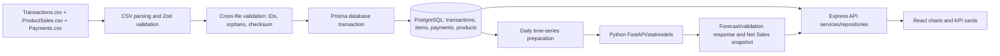

# METRICAST Objective and KPI Source-Code Audit

**Audit scope:** Read-only review of the repository on 15 October 2026. This document records implementation evidence, not a claim that current production data, questionnaire findings, or forecast accuracy values have been independently verified. No application code, data, migrations, or configuration values were changed.

## 1. Verified technology stack and architecture

| Layer | Verified technology | Purpose | Evidence |
|---|---|---|---|
| Frontend | TypeScript, `react` `^19.2.8`, `vite` `^8.2.0` | Browser user interface and build | `frontend/package.json`, `frontend/src/main.tsx` |
| Styling/UI | `tailwindcss` `^4.3.3`, Radix UI, Lucide | Responsive styling and controls | `frontend/package.json` |
| Charts/data fetching | `recharts` `^3.10.1`, `@tanstack/react-query` `^5.101.4`, `axios` `^1.19.0` | Charts, server-state cache, HTTP client | `frontend/package.json`, `frontend/src/services/api-client.ts` |
| Backend | TypeScript, `express` `^5.2.1`, `zod` `^3.24.3` | Versioned REST API and validation | `backend/package.json`, `backend/src/app.ts` |
| Database | PostgreSQL, Prisma `^6.7.0` | Relational persistence and ORM | `database/prisma/schema.prisma`, `backend/package.json` |
| Forecast service | Python, FastAPI `>=0.115,<1.0`, NumPy, pandas, statsmodels `>=0.14,<0.15` | Statistical forecast computation | `forecast-service/app.py`, `forecast-service/requirements.txt` |
| Tests | Vitest `^4.1.10`, Supertest `^7.2.2` | Backend tests | `backend/package.json`, `backend/src/**/*.test.ts` |

### Confirmed execution path

The frontend uses Axios with `VITE_API_BASE_URL` fallback, bearer JWT attachment, and one refresh/retry flow in `frontend/src/services/api-client.ts`. The backend mounts protected feature routers under `/api/v1` in `backend/src/routes/api.ts`; it communicates with the forecast service through the provider defined in `backend/src/services/forecast-provider.ts`.

## 2. Objective 2 — POS analysis and preprocessing evidence

### A. Import, validation, and persistence lifecycle

| Step | Actual rule/behavior | Evidence |
|---|---|---|
| CSV parsing/header check | `csv-parse/sync` parses rows; each required Transactions, ProductSales, or Payments header must exist. Missing headers block parsing. | `parseCsv`, `expectedHeaders`, `backend/src/database/pos-import.service.ts:80-131` |
| Type/data validation | Zod schemas require nonblank IDs/text; non-negative currency; non-negative integer guest count; positive item quantity; valid date/time. Invalid rows become `RowError` entries. | `transactionRowSchema`, `productSalesRowSchema`, `paymentRowSchema`, `backend/src/database/pos-validation.ts:56-95` |
| Transaction IDs/invoices | `TransactionID` and `InvoiceNo` are required. `Transaction.sourceTransactionId` and `invoiceNo` are unique database fields. Repeated incoming transaction IDs are validation errors. | `validateCrossDataset`; `Transaction` model, `database/prisma/schema.prisma` |
| Cross-file matching | ProductSales/Payments whose TransactionID is absent from Transactions become orphan errors. Transactions without child items/payments are warnings. | `validateCrossDataset`, `backend/src/database/pos-import.service.ts:166-255` |
| Duplicate batch | SHA-256 checksum is calculated from source contents; an already imported exact export raises duplicate-import warning/blocking behavior. | `checksum`, `validateCrossDataset`, `ImportBatch.sourceChecksum` |
| Date/time normalization | Accepted dates are DD/MM/YYYY, YYYY-MM-DD, or DDMMYYYY; valid time is H:mm:ss/HH:mm:ss. Source date/time is turned into `+08:00` timestamp. | `canonicalDate`, `canonicalTime`, `transactionOccurredAt`, `backend/src/database/pos-validation.ts` |
| Product/category normalization | `sourceKey(...parts)` trims, lowercases English locale, collapses whitespace, and joins category + name. | `sourceKey`, `backend/src/database/pos-validation.ts:97-99`; import service product matching |
| Error reporting | Validation returns errors with file, row, optional field, message, and raw row; `ImportError` persists errors for a batch. | `PosValidationResult`; `ImportError` model |
| Atomic persistence | Import service uses Prisma transaction-safe persistence; malformed/blocked source data is not accepted as a normal successful import. | `PosImportService` and tests, `backend/src/database/pos-import.service.ts`, `pos-import.service.test.ts` |

### B. What counts as preprocessing?

| Item | Status | Actual implementation/limitation |
|---|---|---|
| Missing values | **Partially implemented** | Blank nullable text becomes `null`; required fields fail validation. Guest count may be null in persisted data, but raw import GuestCount is validated non-negative. |
| Duplicate removal | **Implemented as rejection/prevention** | Duplicate incoming TransactionIDs are errors; `sourceTransactionId`, invoice, import checksum, and child `(transactionId, sourceRow)` keys enforce identity. It does not silently merge duplicates. |
| Type conversion | **Implemented** | Currency strings become finite non-negative numbers; counts become integers; dates/times normalized. |
| Product/category normalization | **Implemented** | Normalized category + product source key, not name-only grouping. |
| Aggregation | **Implemented** | Services/repositories group records by Manila day/hour, product, category, channel, order type, and payment method. Aggregation is analytics, not ML preprocessing. |
| Outlier treatment | **Not implemented** | No outlier-detection/removal method was found. |
| Cancelled/voided filtering | **Partially implemented** | Analytics consistently filter `deletedAt: null`. No explicit POS cancelled/voided status field/rule was found. |
| Missing dates for forecasts | **Implemented** | `completeDailySeries` fills calendar dates between first/last observed date with zero. This is a modeling assumption. |

### C. Persistence and integrity

`Transaction` is the header/parent record; `TransactionItem` and `Payment` use foreign keys to it. Products link to Categories; items link to Products. ImportBatch tracks source files/counts/status; ImportError records diagnostics; CustomerFeedbackImport and CustomerFeedbackRating are separate from POS data. See `database/prisma/schema.prisma` models `Transaction`, `TransactionItem`, `Payment`, `Product`, `Category`, `ImportBatch`, and `ImportError`.

Important key rules: UUID primary keys; `Transaction.sourceTransactionId` and `invoiceNo` are unique; child rows are unique by `(transactionId, sourceRow)`; Product uses a unique normalized `sourceKey`; `unitCost = null` means missing while an explicit `0` remains configured.

### D. Dashboard preparation/API map

| Page | Backend route/service | Frontend client/hook | Grouping/timezone |
|---|---|---|---|
| Dashboard | `/dashboard/*`; `DashboardService` | `dashboard.api.ts`; `dashboard-page.tsx` | Start/end `+08:00`; some legacy grouped method uses ISO date and should be reviewed before claiming all dashboard grouping is Manila-safe. |
| Sales Analytics | `/sales/*`; `SalesAnalyticsService.bucket` | `sales-analytics.api.ts`, sales hooks | SQL uses `occurredAt AT TIME ZONE 'Asia/Manila'`. |
| Customer Analytics | `/analytics/customer`; `CustomerAnalyticsService` | `customer-analytics.api.ts` | Manila for hourly SQL; guest eligibility uses `guestCount > 0`. |
| Product Analytics | `/analytics/products`; `ProductAnalyticsService` | product hooks | Uses selected date/channel/order filters on transaction items. |
| Operational | `/analytics/operational`; `OperationalService` | operational hooks | Manila day/hour; all non-deleted transactions counted. |
| Reports | `/reports/metadata` plus existing analytics APIs | `reports.api.ts`, `reports-page.tsx` | Inherits global sales filters. |
| Forecasts | `/forecast/*`; `ForecastingService` | forecasting hooks | Daily historical series and explicit validation range. |

## 3. KPI calculation audit

`n(x) = Number(x ?? 0)`. All listed transaction analytics filter out `deletedAt != null`; date filters use selected start `00:00:00+08:00` and end `23:59:59.999+08:00` unless noted.

| Display metric | Actual formula/rule | Source / API / fields | Null/zero and risk notes |
|---|---|---|---|
| Gross Sales | `Σ Transaction.grossSales` | `SalesAnalyticsService.summary`; `/sales/summary` | Imported source definition; code does not independently recompute it. |
| Net Sales | `Σ Transaction.netSales` | same; Dashboard `summary` | Basis for many metrics. Discount/service-charge accounting depends on POS export fields. |
| Discounts | `Σ Transaction.discountAmount` | `/sales/summary` | null aggregate becomes 0. |
| Service Charge | `Σ Transaction.serviceCharge` | `/sales/summary` | null aggregate becomes 0. |
| Total Transactions | `COUNT(Transaction.id)` | Dashboard/Sales/Operational summaries | All non-deleted selected transactions; no completed-status field exists. |
| AOV / Average Sales per Transaction | `Σ netSales / COUNT(transaction)`; alternatively Prisma `_avg(netSales)` which is algebraically identical for same records | `OperationalService.getAnalytics:147-150`; `SalesAnalyticsService.summary` | 0 when count is 0. Not an average of daily averages. |
| Average Daily Sales | selected Net Sales ÷ inclusive calendar days | `frontend/src/pages/dashboard-page.tsx` | Calendar days, not only recorded days. |
| Average Sales/Hour | selected Net Sales ÷ configured operating hours | `dashboard-page.tsx`, `frontend/src/utils/operating-hours.ts` | Depends on configured/derived operating hours. |
| Sales by day/hour/month | `Σ netSales`, `Σ grossSales`, `COUNT(*)` per Manila bucket | `SalesAnalyticsService.bucket`; `/sales/daily`, `/sales/hourly`, `/sales/monthly` | Hour labels represent local hour buckets. |
| Product revenue / units | per product `Σ TransactionItem.salesAmount`, `Σ quantity` | `ProductAnalyticsRepository`, `ProductAnalyticsService`; `/analytics/products` | Product identity is product ID. |
| Top / lowest products | Sort quantity descending/ascending, retain first 10 | `ProductAnalyticsService.getAnalytics:59,88` | Ranking stated as quantity, not revenue; do not relabel it. |
| Category performance | Sum product revenue/quantity grouped by category | `ProductAnalyticsService.getAnalytics` | Uses item-level sales amount. |
| Total guests | `Σ guestCount` for `guestCount > 0` | `CustomerAnalyticsRepository.guestSummary`; `/analytics/customer` | Zero/null guests excluded from guest population. |
| Avg guests/transaction | eligible guest total ÷ eligible transaction count | `CustomerAnalyticsService.getAnalytics:47-64` | Denominator excludes zero/null guest count. |
| Guest days/hours | `Σ guestCount`, count eligible transactions, grouped Manila day/hour | `guestDays`, `diningHours` repository methods | This is guest activity, not all transaction volume. |
| Daily transactions | `COUNT(*)` per selected Manila day | `transactionDays` | Includes transactions with zero/null guests. |
| Customer satisfaction | averages/counts/distribution of separate 1–5 feedback fields | `CustomerFeedbackService.analytics`; `/analytics/satisfaction` | No data returns null/empty; never inferred from POS. |
| Operational peak/slow hour | Sort local-hour transaction counts descending/ascending | `OperationalRepository.hourlyOperations`, `OperationalService` | Includes all transactions, unlike guest peak hour. |
| Dine-in/Takeout/Delivery shares | matching order-type count ÷ all selected transactions ×100 | `OperationalService.shareFor:140-145` | Delivery regex matches only normalized `delivery`; channels differ from order types. |
| Payment distribution | Sum `Payment.amount`, normalize known payment method labels, rank by amount | `OperationalService.paymentCategory` | Payment amount is not automatically equal to Net Sales. |
| Sold products | count distinct sold product IDs | `FinancialProjectionRepository.costCoverage` | Product ID, not display name. |
| Configured/missing costs | configured iff `unitCost IS NOT NULL`; missing iff null | `costCoverage` | **₱0.00 is configured.** |
| Product coverage | configured distinct sold products ÷ distinct sold products ×100 | `FinancialProjectionService.historicalBasis` | 0 denominator returns 0. |
| Item coverage | configured sold items ÷ sold items ×100 | same | Based on item/quantity coverage returned by repository. |
| Historical estimated cost | `Σ(quantity × unitCost)` for configured sold items | `FinancialProjectionRepository.costCoverage` | Missing-cost products are not fabricated. |
| Estimated product cost | forecast Net Sales × `(historical estimated cost / historical Net Sales)` | `calculateFinancialProjection:37-58` | Estimate, not actual ledger cost. |
| Estimated overhead | estimated product cost × `(overheadRate/100)` | same | Overhead is configurable `FinancialSetting.overheadRate`. |
| Total cost / profit / margin | product cost + overhead; sales − total cost; profit ÷ sales | same | Null projection if historical/forecast sales ≤ 0. |

**Consistency finding:** Dashboard and Customer Analytics share `revenuePerGuest()` but its denominator is reconstructed as `round(averageGuestCount × totalTransactions)` in `backend/src/lib/revenue-per-guest.ts`; it is not the same explicit positive-guest sum used for party-size analytics. This is intentional code sharing but should be documented as a definition risk before claiming every guest KPI uses the same population.

## 4. Objective 3 — forecasting, validation, and financial projection evidence

### Model specification

| Target | Model selected | Exact configuration |
|---|---|---|
| Net Sales | `HOLT_WINTERS_WEEKLY` | `ExponentialSmoothing`: additive trend, damped trend, additive seasonality, `seasonal_periods=7` |
| Transaction Volume, Guest Count, Product Demand | `SARIMA` via statsmodels `SARIMAX` without exogenous variables | `order=(1,1,1)`, `seasonal_order=(1,0,1,7)`, no stationarity/invertibility enforcement |

**Important:** `SARIMAX` is the statsmodels class used for the SARIMA branch, but no exogenous variables are passed; describe it as SARIMA-style seasonal ARIMA, not machine learning, deep learning, or a neural network. Evidence: `forecast-service/sarima_forecast.py`, `modelForTarget` in `backend/src/services/forecasting.service.ts:109-114`.

### Forecast workflow

1. `ForecastingRepository` aggregates historical values (Net Sales, transaction volume, guests, or selected product demand).
2. `ForecastingService.getNetSalesForecast` checks numeric chronological uniqueness and needs at least 30 daily observations.
3. `completeDailySeries` fills missing dates between first/last observation with zero values.
4. Backend calls a local Python process or configured remote forecast service through `ForecastProvider`; remote mode uses service token and configured timeout (`FORECAST_SERVICE_TIMEOUT_MS`, default declared in `.env.example` as 55000 ms).
5. FastAPI `/forecast` validates model name, fits chronological training data, calculates held-out validation values, and—unless validation-only—refits the selected model on all submitted series for future predictions.
6. Results include `predicted`, `lowerBound`, `upperBound`; Holt-Winters bounds are empirical residual-based approximations, while SARIMA uses `conf_int()`.
7. `generateNetSalesForecast` persists forecast rows and a metadata snapshot; `getLatestNetSalesForecast` retrieves it and detects stale historical input fingerprint.

Routes: `GET /api/v1/forecast/net-sales`, `POST /api/v1/forecast/net-sales/generate`, `GET /api/v1/forecast/validation`, and target-generation routes in `backend/src/routes/forecasting.routes.ts`.

### Validation method and formulas

- **Split:** chronological holdout. Training dates are `< validationStart`; validation dates are `validationStart ≤ date ≤ validationEnd`.
- **Leakage protection:** future holdout values are excluded from the validation fit.
- **Refit:** only non-validation-only forecast requests refit the model on the full submitted series before future prediction.
- **MAPE:** `mean(abs((actual - predicted) / actual)) × 100`, using only `actual != 0`; zero actuals are counted as excluded.
- **RMSE:** `sqrt(mean((actual - predicted)^2))`, including all validation errors.
- **MAE:** repository historical-accuracy SQL can calculate average absolute error for stored forecasts, but the FastAPI validation response exposes MAPE/RMSE.
- **Not implemented:** rolling cross-validation, baseline comparison, statistical significance testing, automatic hyperparameter search, or external-regressor modeling.

### Objective/claim assessment

| Research claim | Status | Reason |
|---|---|---|
| Analyze/preprocess three POS CSV sources | **Supported** | Source validation, normalization, cross-file matching, persistence, and analytic aggregation are implemented. |
| Robust statistical preprocessing/outlier treatment | **Partially supported** | Validation/type/date handling and zero-filled missing forecast dates exist; outlier treatment is absent. |
| Develop predictive models | **Supported** | Holt-Winters and SARIMA branches are implemented. |
| Validate models for accuracy/reliability | **Partially supported** | Chronological holdout + MAPE/RMSE exist, but reliability/accuracy value needs an actual preserved run. |
| Generate financial projections | **Supported** | Code calculates estimates from forecast Net Sales, historical configured costs, and overhead. |
| Prove accurate/reliable forecasts | **Needs empirical evidence** | Code is not a measured accuracy result. |
| Improve operational efficiency | **Needs empirical evidence** | Dashboards display operations; no before/after causal outcome study exists in code. |

## 5. Traceability matrix

| Research Objective / Feature | Implementation Step | File Path | Function / Class | API Endpoint | Database Fields | Formula / Rule | Evidence / Notes |
|---|---|---|---|---|---|---|---|
| Objective 2: POS import | Parse/header/schema validation | `backend/src/database/pos-import.service.ts`; `pos-validation.ts` | `parseCsv`, `validateRows`, schemas | `POST /imports/validate`, `/imports/pos` | source CSV fields | invalid rows become errors | Required three-file workflow. |
| Objective 2: cross-file integrity | IDs/orphans/checksum | same | `validateCrossDataset` | same | TransactionID, checksum | duplicate IDs/orphans block | Missing child records warn. |
| Objective 2: persistence | Transaction-safe import | `pos-import.service.ts`; `schema.prisma` | `PosImportService` | `/imports/pos` | Transaction/Item/Payment/Batch | FK/unique constraints | Do not claim raw data is cleaned beyond rules listed. |
| KPI aggregation | Sales/day/hour | `backend/src/services/sales-analytics.service.ts` | `summary`, `bucket` | `/sales/summary`, `/sales/daily` | grossSales/netSales/etc. | sum/count Manila buckets | Actual historical values. |
| Customer KPI | Guest vs transaction population | `customer-analytics.repository.ts` | `eligibleGuestWhere`, `transactionDays` | `/analytics/customer` | guestCount | guest >0 vs all tx | Intentional population distinction. |
| Product KPI | Item product/category aggregation | `product-analytics.*` | `getAnalytics` | `/analytics/products` | quantity/salesAmount/productId | sums then ranking | Product ID identity. |
| Objective 3: training | Daily-series prep/model selection | `forecasting.service.ts` | `completeDailySeries`, `modelForTarget` | `/forecast/*` | daily aggregates | ≥30 observations | Net Sales differs from other targets. |
| Objective 3: model | Model fit/forecast | `forecast-service/sarima_forecast.py` | `fit_holt_winters`, `fit_sarima`, `forecast` | `POST /forecast` internal | submitted daily series | model table above | Python service. |
| Objective 3: validation | Holdout metrics | same | validation/training slices | `/forecast/validation` | actual/predicted | MAPE/RMSE | Chronological, not random. |
| Financial projection | Cost coverage/projected totals | `financial-projection.service.ts` | `historicalBasis`, `calculateFinancialProjection` | `/financial-projections/summary` | unitCost, quantity, netSales, overhead | ratio-based estimate | Not audited profit. |
| Forecast report retrieval | Latest snapshot/stale check | `forecasting.service.ts` | `getLatestNetSalesForecast` | `/forecast/net-sales` | Forecast metadata | fingerprint comparison | Reports uses current forecast hook. |

## 6. Panel-ready answers

**How do you preprocess the data?** “We validate required headers and values, normalize product/category identity, verify relationships across Transactions, ProductSales, and Payments, normalize source dates and times to the restaurant timezone, and reject invalid or duplicate records. We do not claim outlier treatment because no outlier-removal algorithm is implemented.”

**How do you validate forecasts?** “We use a chronological holdout: earlier observations train the model and later selected dates are compared with predictions using MAPE and RMSE. A displayed metric is only defensible when we preserve its model, data cutoff, train/validation dates, and observation count.”

**Are projected profits actual?** “No. They are estimates based on forecasted Net Sales, configured unit costs, the historical configured-cost ratio, and a configurable overhead rate. Missing unit costs produce incomplete coverage rather than invented costs.”

## 7. Most important panel demonstration files

- **Objective 2:** `backend/src/database/pos-validation.ts`, `backend/src/database/pos-import.service.ts`, `database/prisma/schema.prisma`, `backend/src/repositories/customer-analytics.repository.ts`.
- **Objective 3:** `backend/src/services/forecasting.service.ts`, `backend/src/services/forecast-provider.ts`, `forecast-service/sarima_forecast.py`, `backend/src/services/financial-projection.service.ts`.
- **KPI formulas:** `backend/src/services/sales-analytics.service.ts`, `backend/src/services/customer-analytics.service.ts`, `backend/src/services/operational.service.ts`, `backend/src/services/product-analytics.service.ts`, `backend/src/repositories/financial-projection.repository.ts`, and `frontend/src/pages/dashboard-page.tsx`.
