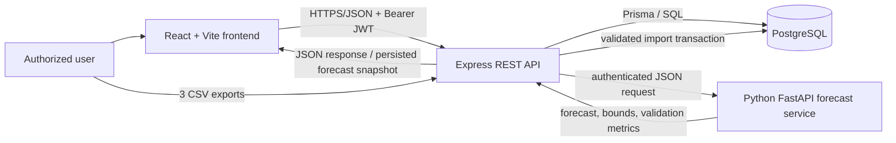

# METRICAST Thesis Defense Q&A Reviewer

> **Evidence rule.** This reviewer is based on the repository as audited on 15 October 2026. “Not verified” means the code does not prove the claim; it is not an allegation that the claim is false. Do not present an unverified number, deployment fact, respondent result, or business outcome as established fact.

## 1. General System Overview

### 1. What is METRICAST?
**Suggested answer:** We developed METRICAST as a web-based KPI dashboard with forecasting for Under the Balete Restaurant. It imports restaurant POS data, validates it, stores it in a relational database, and presents sales, customer, product, operational, forecasting, reporting, and financial-planning views.

**Why this is correct:** The system is a custom web application, not a BI report file. **Evidence:** `frontend/src/routes/app-routes.tsx`, `backend/src/routes/api.ts`. **Possible follow-up:** *Does it prove better restaurant performance?* — No; it supports review and planning, but improvement needs before-and-after operational evidence.

### 2. Why is it a web application rather than Power BI?
**Suggested answer:** We chose a custom web application because METRICAST needs authenticated roles, controlled CSV import, validation, database persistence, forecasting-service integration, and configurable product-cost settings. Power BI is useful as related literature, but it is not the implementation platform of this system.

**Why this is correct:** The repository contains React, Express, Prisma, and FastAPI code, not Power BI artifacts. **Evidence:** `frontend/package.json`, `backend/package.json`, `forecast-service/app.py`. **Possible follow-up:** *Can Power BI still be used?* — It could be considered for future reporting, but it is outside the implemented architecture.

### 3. What problem does the system address?
**Suggested answer:** It centralizes separately exported POS records into a validated analytical system. This reduces manual consolidation and provides consistent KPI, trend, and forecast views from the selected data.

**Why this is correct:** The import workflow requires transaction, product-sales, and payment datasets and validates their relationships. **Evidence:** `backend/src/database/pos-import.service.ts`. **Possible follow-up:** *Does it replace the POS?* — No; it analyzes imported POS exports and does not directly operate the restaurant POS.

### 4. What is outside the scope?
**Suggested answer:** The application does not directly modify POS transactions, run inventory operations, or prove causal business improvement. Financial projections are estimates and should not be treated as audited accounting statements.

**Why this is correct:** Product costs and overhead are configurable assumptions; projections are calculated from them. **Evidence:** `backend/src/services/financial-projection.service.ts`. **Possible follow-up:** *Can it be extended?* — Yes, but an inventory or live-POS integration would need separate requirements and validation.

## 2. Problem, Objectives, and Scope

### 5. How do the objectives map to the system?
**Suggested answer:** The dashboard and analytics modules address KPI monitoring; the forecasting module addresses predictive analysis; financial projections address planning estimates; and the tests and questionnaire process support evaluation. Each objective should be described using only features present in the deployed version being defended.

**Why this is correct:** Modules are explicitly registered in the protected API router. **Evidence:** `backend/src/routes/api.ts`. **Possible follow-up:** *Are all planned features implemented?* — We should verify each claimed feature against the release being demonstrated.

### 6. Does METRICAST use live POS integration?
**Suggested answer:** No direct POS database connector is implemented in this repository. Users upload the required CSV exports through the controlled import workflow.

**Why this is correct:** Import routes accept multipart upload fields for three files. **Evidence:** `backend/src/routes/api.ts`, `backend/src/database/pos-import.service.ts`. **Possible follow-up:** *Why CSV?* — It is a practical integration boundary for the available source data, but it introduces an import step.

### 7. What data does the system analyze?
**Suggested answer:** It analyzes transaction headers, product-sale line items, payments, and separately imported customer-satisfaction feedback. These sources support different metrics and should not be treated as interchangeable.

**Why this is correct:** The schema has distinct Transaction, TransactionItem, Payment, and CustomerFeedbackRating models. **Evidence:** `database/prisma/schema.prisma`. **Possible follow-up:** *Are survey ratings inferred from sales?* — No; ratings are separate feedback records.

### 8. Does the system make decisions automatically?
**Suggested answer:** No. It calculates and presents historical indicators, forecasts, and estimated projections to support human decisions. Managers remain responsible for interpreting the results and assumptions.

**Why this is correct:** Forecasts and financial projections return analytical outputs but do not automate restaurant actions. **Evidence:** `backend/src/services/forecasting.service.ts`, `backend/src/services/financial-projection.service.ts`. **Possible follow-up:** *Is it AI?* — It uses statistical time-series models, not a neural-network decision engine.

## 3. Programming Languages and Technology Stack

### 9. What programming languages did you use?
**Suggested answer:** We used TypeScript for the React frontend and Express backend, and Python for the standalone forecasting service. SQL is generated through Prisma and raw parameterized queries where time-based aggregation is needed.

**Why this is correct:** TypeScript files make up the web application; the forecast service is Python. **Evidence:** `frontend/src/main.tsx`, `backend/src/app.ts`, `forecast-service/app.py`. **Possible follow-up:** *Why TypeScript?* — It adds type checking that helps prevent API and calculation mismatches.

### 10. What is React and what is Vite?
**Suggested answer:** React is the frontend library used to build reusable interface components. Vite is the development server and production build tool that bundles the React application.

**Why this is correct:** React renders the root application and Vite supplies frontend scripts. **Evidence:** `frontend/src/main.tsx`, `frontend/package.json`. **Possible follow-up:** *Are they the same thing?* — No; React builds the interface and Vite builds/serves it.

### 11. How is the interface styled and visualized?
**Suggested answer:** The interface uses Tailwind CSS utility classes with light/dark theme support. Recharts provides the interactive charts, while Lucide and React Icons provide icons.

**Why this is correct:** These packages and class names are present in the frontend. **Evidence:** `frontend/package.json`, `frontend/src/components`. **Possible follow-up:** *Does Recharts calculate the data?* — No; the backend and frontend transformations calculate data, while Recharts renders it.

### 12. What is the backend stack?
**Suggested answer:** The backend is an Express 5 application written in TypeScript. It exposes versioned HTTP endpoints, validates request data with Zod, and uses Prisma to access PostgreSQL.

**Why this is correct:** Express, Zod, Prisma, and TypeScript are declared dependencies and used in the server. **Evidence:** `backend/package.json`, `backend/src/app.ts`. **Possible follow-up:** *What is Prisma?* — It is an ORM that maps application models to database tables and queries.

## 4. System Architecture and Data Flow

### 13. What is the architecture?
**Suggested answer:** METRICAST has a browser frontend, a protected REST backend, a PostgreSQL database, and a Python forecast service. The frontend requests data from the backend; it does not access the database directly.

**Why this is correct:** The frontend uses Axios API calls, while repositories use Prisma on the server. **Evidence:** `frontend/src/services/api-client.ts`, `backend/src/repositories`. **Possible follow-up:** *Why separate the backend?* — It protects database access and centralizes validation and business logic.

### 14. What happens when a user opens the application?
**Suggested answer:** React mounts global providers for server-state caching, theme, authentication, routing, filters, and an error boundary. Pages then request only the data needed for their current route and filters.

**Why this is correct:** Provider nesting and the error boundary are explicit. **Evidence:** `frontend/src/main.tsx`. **Possible follow-up:** *What if a page crashes?* — The application error boundary is intended to show a fallback instead of an entirely blank interface.

### 15. How does data reach a chart?
**Suggested answer:** A chart calls a frontend API hook or service, the backend authenticates the request, services query/aggregate records, and JSON data returns to the chart. The selected date and other filters are passed as request parameters.

**Why this is correct:** Dashboard APIs and services follow this pattern. **Evidence:** `frontend/src/services/dashboard.api.ts`, `backend/src/services/dashboard.service.ts`. **Possible follow-up:** *Does the chart query PostgreSQL?* — No; only the backend does.

### 16. Are forecasts persisted?
**Suggested answer:** Generated Net Sales forecasts are saved as forecast records with a metadata snapshot. The system can then retrieve the latest matching snapshot for reports and financial projections, while checking whether the historical input has become stale.

**Why this is correct:** The service calls `saveNetSalesGeneration` and stores an input fingerprint. **Evidence:** `backend/src/services/forecasting.service.ts`. **Possible follow-up:** *Are all forecast targets stored identically?* — Net Sales persistence is confirmed; target-specific persistence should be demonstrated for any additional claim.

## 5. APIs and Backend Communication

### 17. Does METRICAST use REST APIs?
**Suggested answer:** Yes. It uses HTTP routes under `/api/v1`, standard methods such as GET, POST, PATCH, and DELETE, and JSON responses for most analytics and management functions.

**Why this is correct:** The API router defines REST-style resources and feature routes. **Evidence:** `backend/src/routes/api.ts`. **Possible follow-up:** *Does it use GraphQL?* — No GraphQL implementation was found.

### 18. Give examples of actual endpoints.
**Suggested answer:** Examples include `POST /api/v1/auth/login`, `GET /api/v1/dashboard/summary`, `POST /api/v1/imports/validate`, `POST /api/v1/imports/pos`, `GET /api/v1/forecast/...`, and `GET /api/v1/financial-projections/summary`. Route availability and exact paths should be read from the active router, not guessed.

**Why this is correct:** Feature routers are mounted by the API router. **Evidence:** `backend/src/routes/api.ts`, `backend/src/routes/*.routes.ts`. **Possible follow-up:** *What format is returned?* — The backend generally returns JSON, often wrapped as `{ data: ... }`.

### 19. How does authentication travel with requests?
**Suggested answer:** The frontend stores the short-lived access token in session storage and attaches it as a Bearer Authorization header. On a 401 response it attempts one refresh request, then retries the original request only if refresh succeeds.

**Why this is correct:** Axios interceptors implement this behavior. **Evidence:** `frontend/src/services/api-client.ts`. **Possible follow-up:** *Is the refresh token exposed in JavaScript?* — The backend is designed to set it as a cookie; do not claim production cookie flags without verifying deployed configuration.

### 20. How are API errors handled?
**Suggested answer:** Backend routes use validation middleware, asynchronous error handling, and a central error handler. The forecasting provider returns unavailable reasons when there is insufficient history, invalid input, or runtime failure.

**Why this is correct:** Request validation and forecast error paths are implemented. **Evidence:** `backend/src/middleware/validate.ts`, `backend/src/lib/errors.ts`, `backend/src/services/forecasting.service.ts`. **Possible follow-up:** *Does every UI show the same error message?* — UI presentation differs by component, so demonstrate the relevant page rather than making a universal claim.

## 6. Database Design and POS Data Integration

### 21. What database does METRICAST use?
**Suggested answer:** The application is configured for PostgreSQL through Prisma. The exact production host is environment configuration and was not disclosed or verified in this reviewer.

**Why this is correct:** Prisma’s datasource provider is PostgreSQL. **Evidence:** `database/prisma/schema.prisma`. **Possible follow-up:** *Why PostgreSQL?* — It supports relational integrity, transactions, indexes, and the analytical queries needed here.

### 22. How are the three POS files related?
**Suggested answer:** Transactions are the parent records. ProductSales rows become TransactionItems and Payments rows become Payment records, both linked to the matching transaction identifier after validation.

**Why this is correct:** The schema has foreign keys from TransactionItem and Payment to Transaction. **Evidence:** `database/prisma/schema.prisma`, `backend/src/database/pos-import.service.ts`. **Possible follow-up:** *Can an orphan item be imported?* — Validation flags it and blocks the import.

### 23. How are duplicate imports prevented?
**Suggested answer:** The import workflow creates a SHA-256 checksum from the submitted source contents and checks for a prior batch with the same checksum. It also detects repeated transaction IDs inside the incoming transaction file.

**Why this is correct:** Both checks are implemented before normal persistence. **Evidence:** `backend/src/database/pos-import.service.ts`. **Possible follow-up:** *Can two different exports contain the same transaction?* — Transaction `sourceTransactionId` is unique, so the database also protects that identity.

### 24. What happens when import validation fails?
**Suggested answer:** Invalid headers, invalid field values, duplicate IDs, or orphan relationships produce validation errors and an import-blocked state rather than partially importing invalid records. Warnings are distinct from blocking errors.

**Why this is correct:** `validateCrossDataset` collects errors and decides readiness. **Evidence:** `backend/src/database/pos-import.service.ts`. **Possible follow-up:** *Are failed batches retained?* — ImportBatch and ImportError models support history and diagnostics; demonstrate the current UI for exact visibility.

## 7. Data Preprocessing and Data Quality

### 25. How are dates and times validated?
**Suggested answer:** The importer accepts defined date and time formats, validates calendar values, and constructs transaction timestamps using the Philippines `+08:00` offset. This avoids treating restaurant-local source times as UTC by default.

**Why this is correct:** Canonical date/time validators and `transactionOccurredAt` are implemented. **Evidence:** `backend/src/database/pos-validation.ts`. **Possible follow-up:** *Why does timezone matter?* — It determines the correct local day and hour for daily and hourly analytics.

### 26. How are missing guest counts treated?
**Suggested answer:** Transaction metrics include valid transactions regardless of guest count. Guest-based metrics and party-size analysis use positive recorded guest counts so zero or missing values do not distort guest statistics.

**Why this is correct:** Customer repository separates normal and `guestCount > 0` filters. **Evidence:** `backend/src/repositories/customer-analytics.repository.ts`. **Possible follow-up:** *Does that remove sales?* — No; it changes only guest-based calculations, not financial totals.

### 27. How are product identities handled?
**Suggested answer:** The importer builds a normalized source key from category and product name, after trimming, lowercasing, and collapsing spaces. A product’s current catalog price is separate from historical item prices stored with each transaction item.

**Why this is correct:** `sourceKey` and Product/TransactionItem fields establish this design. **Evidence:** `backend/src/database/pos-validation.ts`, `database/prisma/schema.prisma`. **Possible follow-up:** *Can duplicate names exist?* — Different categories can represent distinct catalog products; identity should not be inferred from name alone.

### 28. What preprocessing is used for forecasting?
**Suggested answer:** Historical records are grouped into daily values, checked for chronological unique numeric observations, and completed with zero values for missing calendar dates within the observed range. The system requires at least 30 daily observations.

**Why this is correct:** These steps are explicit in the forecast service. **Evidence:** `backend/src/services/forecasting.service.ts`. **Possible follow-up:** *Are zeros always truly no sales?* — They are a modeling convention for missing calendar dates, so this assumption should be documented as a limitation.

## 8. Forecasting Model

### 29. Does METRICAST use SARIMA or SARIMAX?
**Suggested answer:** SARIMA is implemented through statsmodels’ `SARIMAX` class without exogenous variables, so it functions as a seasonal ARIMA model rather than a model using external regressors. However, the current Net Sales path uses Holt-Winters weekly, not SARIMA.

**Why this is correct:** The Python service calls `SARIMAX` for the SARIMA branch and `ExponentialSmoothing` for Holt-Winters. **Evidence:** `forecast-service/sarima_forecast.py`. **Possible follow-up:** *Why the distinction?* — SARIMAX can support exogenous inputs, but no exogenous variables are supplied here.

### 30. What is the current Net Sales model?
**Suggested answer:** Net Sales uses additive Holt-Winters exponential smoothing with an additive damped trend, additive weekly seasonality, and seasonal period 7. It is selected by `modelForTarget('net_sales')`.

**Why this is correct:** This is the current production code path. **Evidence:** `backend/src/services/forecasting.service.ts`, `forecast-service/sarima_forecast.py`. **Possible follow-up:** *Why weekly seasonality?* — Seven days represents recurring day-of-week patterns; it is an implementation choice, not proof that every dataset has strong weekly seasonality.

### 31. What are the SARIMA parameters used for other targets?
**Suggested answer:** The SARIMA branch uses order `(1,1,1)` and seasonal order `(1,0,1,7)`. In simple terms, it uses one recent lag, one differencing step for trend, one moving-average error term, and a weekly seasonal cycle.

**Why this is correct:** These parameters are hard-coded in the forecast function. **Evidence:** `forecast-service/sarima_forecast.py`. **Possible follow-up:** *Were parameters automatically optimized?* — No automatic model selection is confirmed by the available code.

### 32. Which metrics can be forecast?
**Suggested answer:** The service supports Net Sales, transaction volume, guest count, and selected-product demand. Net Sales is routed to Holt-Winters; the other declared targets route to SARIMA.

**Why this is correct:** `ForecastTarget` and `modelForTarget` define this behavior. **Evidence:** `backend/src/services/forecasting.service.ts`. **Possible follow-up:** *Does it forecast all products at once?* — Product demand is for a selected product when sufficient history is available.

## 9. Forecast Validation and Accuracy

### 33. How is validation performed?
**Suggested answer:** Validation is chronological: observations before the selected validation start date train the model, and observations inside the selected validation period are held out for comparison. It is not a random shuffle.

**Why this is correct:** The provider constructs separate training and validation slices by date. **Evidence:** `forecast-service/sarima_forecast.py`, `backend/src/services/forecasting.service.ts`. **Possible follow-up:** *Why not random split?* — Randomly mixing future data into training would leak information in a time series.

### 34. What is MAPE?
**Suggested answer:** MAPE is the average absolute percentage error between actual and predicted values. For example, if actual sales are 100 and prediction is 90, that observation contributes 10% error.

**Why this is correct:** The forecast service computes absolute percentage error only where actual is not zero. **Evidence:** `forecast-service/sarima_forecast.py`. **Possible follow-up:** *What happens at zero actual sales?* — That row is excluded from MAPE to avoid division by zero.

### 35. What is RMSE?
**Suggested answer:** RMSE is the square root of the average squared prediction errors, expressed in the same unit as the target. It penalizes large errors more heavily than small ones.

**Why this is correct:** The service computes `sqrt(mean((actual - predicted)^2))`. **Evidence:** `forecast-service/sarima_forecast.py`. **Possible follow-up:** *Which is better, MAPE or RMSE?* — Neither alone; MAPE is relative while RMSE shows error magnitude in pesos or target units.

### 36. What accuracy did the system achieve?
**Suggested answer:** We should report only a metric shown by a preserved validation run for the demonstrated dataset, date range, and model version. The repository code proves the calculation method, but it does not prove a universal or current accuracy percentage.

**Why this is correct:** Metrics depend on data and selected validation range. **Evidence:** `backend/src/services/forecasting.service.ts`. **Possible follow-up:** *How do you obtain it?* — Run the validation endpoint/UI, preserve the date range and output, and include its observation count.

## 10. KPI Formulas and Dashboard Interpretation

### 37. How is Total Sales calculated?
**Suggested answer:** Total Sales is the sum of imported gross sales for the filtered transactions. It remains distinct from Net Sales, which uses the transaction net-sales field.

**Why this is correct:** Dashboard summary aggregates both `grossSales` and `netSales`. **Evidence:** `backend/src/services/dashboard.service.ts`. **Possible follow-up:** *Are discounts included?* — Net Sales reflects the imported net-sales field; the exact POS definition comes from the source export.

### 38. How is Average Daily Sales calculated?
**Suggested answer:** The dashboard divides selected Net Sales by inclusive calendar days in the active range. It is not an average only across days that happened to have imports.

**Why this is correct:** Frontend KPI code uses the selected range’s calendar-day count. **Evidence:** `frontend/src/pages/dashboard-page.tsx`. **Possible follow-up:** *Why include empty days?* — It represents average sales per calendar day in the selected period.

### 39. How is Average Sales per Transaction calculated?
**Suggested answer:** It is total Net Sales divided by total completed/qualifying transactions for the same selected scope. It is not the average of daily averages.

**Why this is correct:** Operational service calculates `totalNetSales / totalTransactions`. **Evidence:** `backend/src/services/operational.service.ts`. **Possible follow-up:** *What if there are no transactions?* — The implementation returns zero rather than dividing by zero.

### 40. How are peak and off-peak hours calculated?
**Suggested answer:** Customer Analytics identifies hours from positive recorded guest activity, while Operational Efficiency groups all transactions by local Manila hour. We must say whether a chart represents guests or transactions.

**Why this is correct:** The repositories intentionally use distinct populations. **Evidence:** `backend/src/repositories/customer-analytics.repository.ts`, `backend/src/repositories/operational.repository.ts`. **Possible follow-up:** *Can a quiet guest hour have many transactions?* — Yes, if transactions have zero or missing recorded guest counts.

## 11. Financial Projections and Product Costing

### 41. Are projected profits actual profits?
**Suggested answer:** No. They are estimated planning figures based on forecasted Net Sales, configured product unit costs, historical cost ratio, and a configurable overhead rate. They are not audited financial statements.

**Why this is correct:** Projection equations calculate estimated cost, overhead, and profit from assumptions. **Evidence:** `backend/src/services/financial-projection.service.ts`. **Possible follow-up:** *Can we make accounting decisions from them?* — They can inform planning, but should be checked against accounting records.

### 42. How does a unit cost affect projections?
**Suggested answer:** Configured unit cost is multiplied by sold quantity to estimate historical product cost, which produces a historical cost ratio applied to forecasted Net Sales. A missing cost reduces coverage and can prevent a ready projection.

**Why this is correct:** Cost coverage and readiness status are calculated before projections. **Evidence:** `backend/src/repositories/financial-projection.repository.ts`, `backend/src/services/financial-projection.service.ts`. **Possible follow-up:** *Is zero cost missing?* — No; an explicit zero cost is configured, while `null` represents missing cost.

### 43. What is operating overhead?
**Suggested answer:** It is a configurable percentage applied to estimated product cost in the projection calculation. It is a planning assumption, not an imported actual expense ledger.

**Why this is correct:** FinancialSetting stores overhead rate and projection service applies it to product cost. **Evidence:** `database/prisma/schema.prisma`, `backend/src/services/financial-projection.service.ts`. **Possible follow-up:** *Why not apply it directly to revenue?* — The implemented formula applies it to estimated product cost; describe the implementation accurately.

### 44. How does incomplete cost coverage affect results?
**Suggested answer:** If sold products lack configured costs, the system reports incomplete cost coverage and does not treat the projection as fully ready. This avoids silently fabricating missing costs.

**Why this is correct:** `INCOMPLETE_COST_COVERAGE` is a service status. **Evidence:** `backend/src/services/financial-projection.service.ts`. **Possible follow-up:** *Can the system infer cost from selling price?* — No; that would be an unsupported assumption.

## 12. Security, Reliability, and Deployment

### 45. How are passwords protected?
**Suggested answer:** Passwords are stored as hashes, and login compares the submitted password against the stored hash using bcrypt. The application does not store plain-text passwords in the User model.

**Why this is correct:** Authentication service calls `bcrypt.hash` and `bcrypt.compare`. **Evidence:** `backend/src/services/auth.service.ts`, `database/prisma/schema.prisma`. **Possible follow-up:** *Can an administrator see passwords?* — Not through the stored password hash.

### 46. How does role-based access work?
**Suggested answer:** The server verifies a JWT access token, places its user and role on the request, and checks allowed roles before sensitive actions. Administrators, managers, and staff have different permissions; administrative user management is restricted further.

**Why this is correct:** `requireAuth` and `requireRole` protect routes. **Evidence:** `backend/src/middleware/auth.ts`, `backend/src/routes/api.ts`. **Possible follow-up:** *Can the frontend alone enforce security?* — No; server-side checks are the meaningful enforcement.

### 47. What security controls are implemented?
**Suggested answer:** Confirmed controls include Helmet headers, CORS allow-list configuration, rate limiting, input sanitization, Zod validation, request-size limits, JWT verification, and audit logs. We should not claim penetration testing, backups, or monitoring unless separately evidenced.

**Why this is correct:** These middlewares are registered in the Express app. **Evidence:** `backend/src/app.ts`. **Possible follow-up:** *Is that perfect security?* — No; it reduces common risks and still requires operational security review.

### 48. How is production configured?
**Suggested answer:** Frontend and backend contain Vercel configuration files, and the backend reads connection, CORS, JWT, and forecast-service settings from environment variables. Exact live URLs, hosting status, database host, backups, and monitoring are not verified from this repository alone.

**Why this is correct:** Deployment configs and environment examples prove configuration support, not deployed state. **Evidence:** `frontend/vercel.json`, `backend/vercel.json`, `backend/.env.example`. **Possible follow-up:** *Does local data equal production data?* — No; environments must use separate configuration and databases.

## 13. Software Testing and ISO/IEC 25010:2023

### 49. What automated tests exist?
**Suggested answer:** The backend uses Vitest and Supertest tests for services, authentication, imports, routes, repositories, and selected forecast behavior. The frontend has lint/build scripts, but a frontend unit-test runner is not declared in its package file.

**Why this is correct:** Test files and scripts are present. **Evidence:** `backend/package.json`, `backend/src/**/*.test.ts`, `frontend/package.json`. **Possible follow-up:** *Does a successful build prove all behavior?* — No; it proves compilation/bundling, not all functional correctness.

### 50. What ISO/IEC 25010 areas can be evaluated?
**Suggested answer:** The study can evaluate its selected characteristics—Functional Suitability, Performance Efficiency, Usability, Reliability, and Security—through a documented instrument and separate technical evidence. Questionnaire perceptions must not be presented as direct proof of response time, security absence of vulnerabilities, or business impact.

**Why this is correct:** Code evidence and respondent evaluation answer different questions. **Evidence:** tests and security middleware; research instrument/results require separate source artifacts. **Possible follow-up:** *Is forecast MAPE an ISO score?* — No; it measures forecast error, not general software quality.

### 51. What is the difference between testing and forecasting validation?
**Suggested answer:** Software testing checks whether functions behave as expected, while forecast validation checks prediction error against held-out historical observations. Both are important but evaluate different things.

**Why this is correct:** Tests exercise code; MAPE/RMSE compare model outputs and actual values. **Evidence:** `backend/src/services/forecasting.service.test.ts`, `forecast-service/sarima_forecast.py`. **Possible follow-up:** *Does good MAPE prove the dashboard is usable?* — No.

### 52. What reliability claim can we safely make?
**Suggested answer:** We can state that the code includes error handling, validation, retries for frontend queries, and an error boundary. We cannot claim a measured uptime, backup recovery time, or production availability without records.

**Why this is correct:** These features are visible in code, while operational evidence is absent. **Evidence:** `frontend/src/main.tsx`, `backend/src/lib/errors.ts`. **Possible follow-up:** *How would you measure reliability?* — Define uptime/error metrics and test recovery procedures in a monitored environment.

## 14. Limitations, Future Improvements, and Difficult Follow-up Questions

### 53. What happens if the forecast service is unavailable?
**Suggested answer:** The backend returns an unavailable result with a reason instead of inventing a forecast. The UI should show the error or unavailable state and the user can retry after the service is restored.

**Why this is correct:** Provider failures are caught and converted into unavailable forecast responses. **Evidence:** `backend/src/services/forecasting.service.ts`, `forecast-service/app.py`. **Possible follow-up:** *Does it automatically fall back to another model?* — No automatic fallback model is confirmed.

### 54. What are the main forecasting limitations?
**Suggested answer:** The model relies on historical data quality, at least 30 daily observations, weekly seasonality assumptions, and the treatment of missing dates as zero. Forecasts cannot account for promotions, weather, holidays, or events unless such variables are added and validated.

**Why this is correct:** No exogenous drivers are passed into the current models. **Evidence:** `forecast-service/sarima_forecast.py`. **Possible follow-up:** *Could you add these factors?* — Yes, with reliably collected variables and a re-evaluated model.

### 55. Can the system prove it improved operational efficiency?
**Suggested answer:** No. It provides operational indicators and planning support, but proving improvement requires a defined baseline, follow-up period, and controlled before-and-after analysis.

**Why this is correct:** No causal outcome-study implementation was found. **Evidence:** repository audit; no operational-impact measurement module identified. **Possible follow-up:** *What could future research measure?* — Report-preparation time, waste, staffing decisions, stock-outs, or sales outcomes with a documented baseline.

### 56. What would you improve first?
**Suggested answer:** We would strengthen live POS integration or reconciliation, establish reproducible forecast-validation reports, add production monitoring/backups evidence, and compare model configurations using rolling validation. We would prioritize changes based on verified business requirements and data quality.

**Why this is correct:** These are clearly separated future improvements, not claims of current implementation. **Evidence:** current CSV workflow and model configuration. **Possible follow-up:** *Why not add more charts first?* — Data quality and reproducibility make later analytics more trustworthy.

## 15. Difficult Follow-up Questions

### 57. Why do you call the system predictive if it is not AI?
**Suggested answer:** Predictive analytics is broader than AI. METRICAST predicts future values with statistical time-series models, which are valid predictive methods without being deep learning or neural networks.

**Why this is correct:** The Python code uses statsmodels statistical models. **Evidence:** `forecast-service/requirements.txt`, `forecast-service/sarima_forecast.py`. **Possible follow-up:** *Would AI automatically be better?* — No; model choice must be validated against the available data and problem.

### 58. Why do confidence intervals matter?
**Suggested answer:** A single forecast is only an estimate; lower and upper bounds communicate uncertainty around it. In the Holt-Winters path, bounds are an empirical residual-based approximation, so we should not overstate them as guaranteed ranges.

**Why this is correct:** Holt-Winters bounds are explicitly residual-based. **Evidence:** `forecast-service/sarima_forecast.py`. **Possible follow-up:** *Are intervals displayed?* — Forecast records include lower and upper bounds; demonstrate the relevant UI in the release being defended.

### 59. What if sales, product items, and payments do not reconcile?
**Suggested answer:** The system validates relationships and records import diagnostics, but the current validation result marks some cross-source financial reconciliation fields as unavailable. We should not claim a full payment-to-sales reconciliation unless it is implemented and demonstrated.

**Why this is correct:** The validation response explicitly labels reconciliation unavailable. **Evidence:** `backend/src/database/pos-import.service.ts`. **Possible follow-up:** *How would you improve it?* — Add documented reconciliation rules after confirming POS export semantics.

### 60. What should you say if you do not know an answer during defense?
**Suggested answer:** I would say, “I do not want to guess. Based on our implementation, the confirmed part is ___; I would verify ___ from the source record or configuration before making that claim.” Then connect the question to the relevant module and offer to demonstrate it.

**Why this is correct:** Honest scope control is stronger than inventing a technical answer. **Evidence:** This reviewer’s confirmed-versus-unverified evidence rule. **Possible follow-up:** *Can you show the proof?* — Open the named route, test, configuration, or source artifact.

## Quick technology reference

| Technology | Purpose | Evidence |
|---|---|---|
| TypeScript | Frontend and backend application code | `frontend/src`, `backend/src` |
| React 19 | User interface | `frontend/src/main.tsx` |
| Vite 8 | Frontend development/build | `frontend/package.json` |
| Tailwind CSS 4 | Utility-first styling | `frontend/package.json` |
| TanStack React Query | Server-state fetching/cache | `frontend/src/main.tsx` |
| Axios | Browser HTTP client | `frontend/src/services/api-client.ts` |
| Recharts | Charts | `frontend/package.json` |
| Express 5 | REST API server | `backend/src/app.ts` |
| Prisma | ORM/database access | `database/prisma/schema.prisma` |
| PostgreSQL | Relational database | `database/prisma/schema.prisma` |
| Python/FastAPI | Forecast service | `forecast-service/app.py` |
| statsmodels | Holt-Winters and SARIMA implementation | `forecast-service/sarima_forecast.py` |
| Vitest/Supertest | Backend automated tests | `backend/package.json` |
